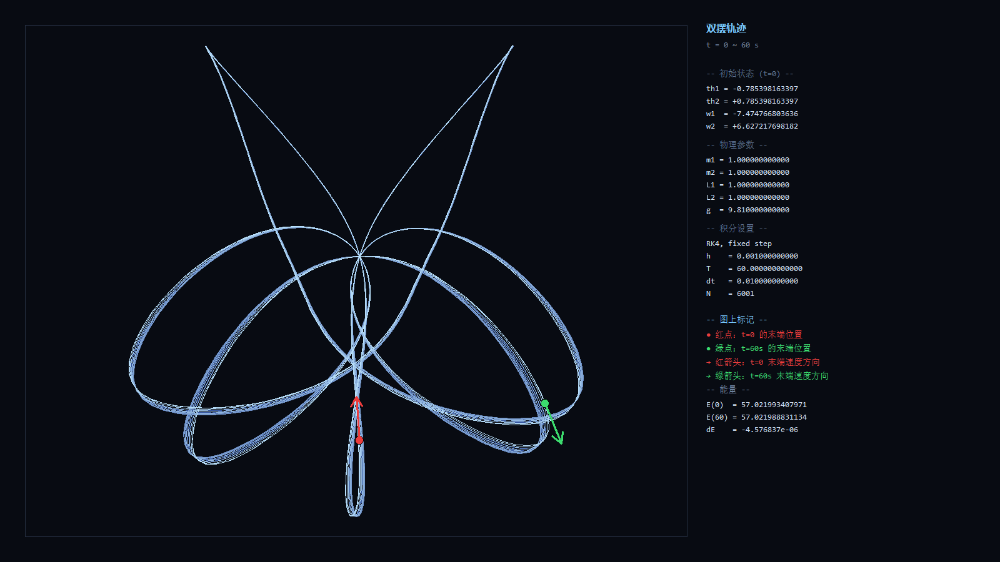

# ChaosMap · Double Pendulum Chaos Map

Colours the initial-condition space of a double pendulum by its **largest Lyapunov exponent**: the more chaotic the initial condition, the brighter the pixel.

Every pixel is a double pendulum released from rest. The program integrates two nearby trajectories per pixel, accumulates the logarithmic separation rate, and maps λ to a colour — a black ordered basin in the centre, a blue transition band, and a white sea of chaos with fine filaments and cusps.


Double-click anywhere to open that pendulum live, watch its phase portrait, and hear it.


Press `T` to export the first 60 seconds of the trajectory as a figure, with the complete initial state (12 decimals), physics parameters, integrator settings and energy drift listed on the right:



## Features

- **OpenCL acceleration** — a 1200×1200 λ field in ≈0.7 s (vs 143 s for the 20-thread CPU version)
- **Three precision levels** — fp32 / float-float (≈48 bit) / fp64, switchable at runtime
- **Symmetry speed-up** — the global view computes half the pixels; the rest is mirrored through point inversion
- **Unlimited zoom** — drag a box to recompute that region, `Z` walks back up the stack
- **Two parameter spaces** — initial angles (−π..π)² or initial angular velocities (−25..25)²
- **Adjustable physics** — masses, lengths, gravity, initial state, all in *Advanced*
- **Live pendulum window** — animation, θ₁–θ₂ phase plot, θ(t) waveforms, frame-by-frame rewind
- **Sonification** — the pendulum drives an audio stream, either live (440× time compression) or as a detected periodic loop
- **Export** — PNG of the current view, a 60 s trajectory figure, 10 s of audio (OGG/WAV)

## Running

Windows 10/11 with an OpenCL-capable GPU (NVIDIA, AMD or Intel integrated — the driver ships `OpenCL.dll`, no CUDA SDK needed).

- `ChaosMap.exe` — Chinese UI
- `ChaosMap-en.exe` — English UI

Both start maximized and begin computing immediately.

## Usage

### Main window

| Action | Effect |
|---|---|
| Left-drag | Zoom into the selection and recompute |
| `Z` | Previous view |
| Double-click | Open the pendulum at that point |
| `Ctrl`+wheel | Visual zoom only (no recompute), 1×–64× |
| Right-drag | Pan |
| Precision / Duration | Samples per side (64–16384) and evolution time (0.5–4000 s) |
| Single / High / Double | fp32 / float-float / fp64 |
| Fast | fast-math kernel, ≈3.7× faster |
| Sharpness | Exponent of the λ→colour mapping |
| Save PNG | 1:1 render to the Desktop |
| Advanced | Mass, length, gravity, initial state, parameter space |
| Zoom ± / Reset 1:1 / Help | View controls and the manual |

### Pendulum window

| Key | Effect |
|---|---|
| Space | Pause / resume |
| ↑ / ↓ | Speed 0.1×–8× |
| ← / → | Rewind 0.01 s (Shift 0.1 s, Ctrl 1 s) |
| `R` | Reset |
| `P` | Play / stop audio |
| `M` | Audio mode: live stream / periodic loop |
| `[` / `]` | Speed ratio or pitch |
| `T` / `Ctrl+S` | Export 60 s trajectory figure |
| `A` / `Ctrl+O` | Export 10 s audio |
| `Esc` | Close |

## How it works

Equations of motion (two point masses on massless rods):

```
den  = 3·m₁ + m₂ − m₂·cos(2θ₁ − 2θ₂)
num₁ = −g·(3m₁+m₂)·sinθ₁ − m₂·g·sin(θ₁−2θ₂) − 2·sin(θ₁−θ₂)·(ω₂²·L₂ + ω₁²·L₁·cos(θ₁−θ₂))
num₂ = 2·sin(θ₁−θ₂)·(ω₁²·L₁·(m₁+m₂) + g·(m₁+m₂)·cosθ₁ + ω₂²·L₂·m₂·cos(θ₁−θ₂))
ω₁' = num₁ / (L₁·den)
ω₂' = num₂ / (L₂·den)
```

**Lyapunov exponent** — two trajectories start `d₀ = 1e-4` apart, are integrated with fixed-step RK4, and the separation is renormalised every step while accumulating `ln(d/d₀)`. Dividing by the total time gives λ.

**Symmetry acceleration** — the equations are invariant under `(θ₁,θ₂) → (−θ₁,−θ₂)`, so the λ field is point-symmetric. The global view computes the left half and mirrors; zoomed views lose the symmetry and compute everything.

**Precision modes** — in angular-velocity space, |ω| reaches 25 rad/s, so fp32 round-off (≈1e-7 per step) accumulates to the same order as d₀ and the numerical noise is mistaken for chaos, inflating λ by 200× or more. float-float (hi/lo pair) keeps ≈48 bits and is 7–9× faster than fp64.

**Audio** — θ(t) is time-compressed 440× into an audio signal. The demo pendulum stays real-time while a separate thread integrates the same initial condition 440× faster into a ring buffer, read back 1:1, so it never repeats.

## Performance (RTX 3060 Laptop, 1200×1200, T=30)

| Configuration | Time |
|---|---|
| fp32 + fast-math | 0.19 s |
| fp32 | 0.72 s |
| float-float | ≈4 s (40 s at 4096²) |
| fp64 | 37.2 s |
| 4096² fp32 | 7 s |

## Building

MinGW-w64 GCC (not an MSVC project):

```bash
gcc -O2 -march=native -mno-avx -mno-avx2 -fopenmp -municode \
    chaosmap.c pendwnd.c cl_gpu.c -o ChaosMap.exe \
    -mwindows -lgdi32 -lcomctl32 -luser32 -lwinmm -lgdiplus -lole32 -luuid -lm

# English build
gcc -O2 -march=native -mno-avx -mno-avx2 -fopenmp -municode -DAPP_EN \
    chaosmap.c pendwnd.c cl_gpu.c -o ChaosMap-en.exe \
    -mwindows -lgdi32 -lcomctl32 -luser32 -lwinmm -lgdiplus -lole32 -luuid -lm
```

> `-mno-avx -mno-avx2` is required. With `-march=native`, GCC emits `vmovdqa` (32-byte aligned stack stores) but Windows message callbacks only guarantee 16-byte alignment — the program then crashes with `0xFFFFFFFFFFFFFFFF` when the pendulum window opens.

## Known limitations

- fp32 badly overestimates λ in angular-velocity space; use High or Double there
- Zooming below the fp32 ulp (≈1.2e-7 near θ≈1.5) quantises the field into flat blocks
- fp64 is throttled by the Windows TDR timeout, so submissions are limited to 8 rows per batch
- RK4 is a non-symplectic fixed-step integrator; energy drifts down slowly (≈2e-5 relative over 60 s at h=0.001)
- OGG export needs ffmpeg; WAV is used otherwise

## License

MIT
