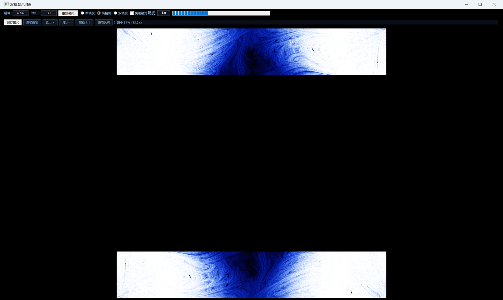
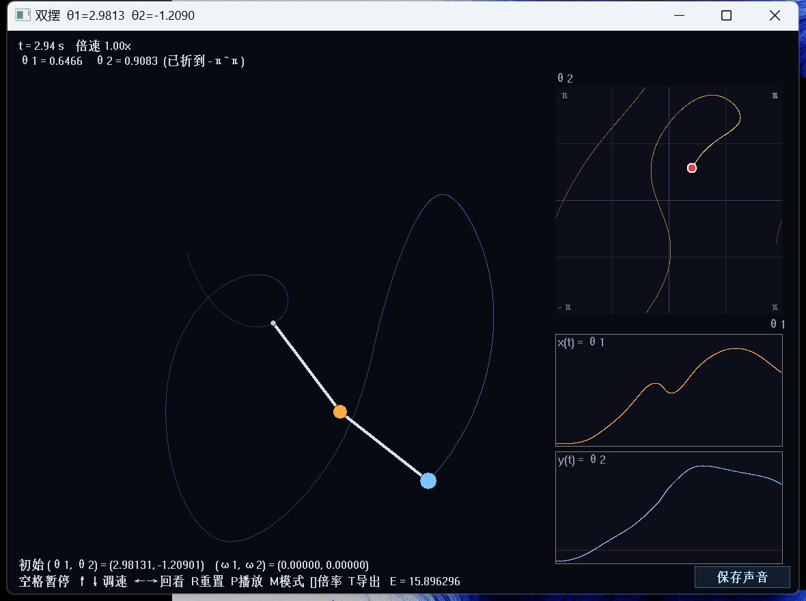

# ChaosMap · 双摆混沌地图

**中文** | [English](README.en.md)

把双摆的初始条件空间画成一张图：**越混沌的地方越亮**。

程序提供两个可执行文件，界面与提示语言不同：

- `ChaosMap.exe` —— 中文界面
- `ChaosMap-en.exe` —— English UI

每个像素对应一个初速度为零的双摆，程序算出它的最大 Lyapunov 指数 λ，再按 λ 上色——中心是稳定摆动的黑色区域，往外是蓝色过渡带，边缘是白得刺眼的混沌区，中间夹着大量细丝与尖角状分形结构。



双击图上任意一点，会弹出那个双摆的实时动画，可以听它的声音、看它的相图。



## 特性

- **GPU 加速**：OpenCL 内核，1200×1200 分辨率的 λ 场约 0.7 秒算完（20 线程 CPU 版要 143 秒）
- **三档精度**：单精度（fp32）/ 高精度（float-float，约 48 位）/ 双精度（fp64），可随时切换
- **对称性加速**：全局视图只算一半像素，另一半靠点反演对称镜像填充
- **无限放大**：左键框选任意区域重新计算，`Z` 逐层返回
- **两种参数空间**：角度空间（−π~π × −π~π）与角动量空间（−25~25 × −25~25）
- **可调物理参数**：两个摆的质量、长度、重力加速度、初始角速度，都在「高级选项」里
- **双摆动画**：实时演示 + θ₁-θ₂ 相图 + θ(t) 波形 + 状态轨迹回看（←/→ 按 0.01/0.1/1 秒步进）
- **把双摆变成声音**：实时流式（轨迹加速 440 倍后当音频播）或周期循环（先提取周期再循环）
- **导出**：当前视图存 PNG、用 matplotlib 风格的图导出 60 秒轨迹、把 10 秒音频存成 OGG/WAV

## 运行

需要 Windows 10/11 与一块支持 OpenCL 的显卡（NVIDIA / AMD / Intel 核显都行，驱动自带 `OpenCL.dll`，不需要 CUDA SDK）。

1. 从 [Releases](../../releases) 下载 `ChaosMap.exe`
2. 双击运行，程序会自动铺满屏幕并开始计算
3. 第一次运行时会在同目录生成 `chaosmap_log.txt`，出问题可以看它

## 操作

### 主窗口

| 操作 | 效果 |
|---|---|
| 左键拖框 | 框选区域按当前精度/时长重算并放大 |
| `Z` | 返回上一层视图 |
| 左键双击 | 打开该点初值对应的双摆动画窗口 |
| `Ctrl` + 滚轮 | 纯视觉缩放（不重算），以鼠标位置为锚点，1×~64× |
| 右键拖动 | 平移视图 |
| 精度 / 时长 | 直接输入，精度 64~16384，时长 0.5~4000 秒 |
| 重新模拟 | 用当前区域与参数重算 |
| 单精度 / 高精度 / 双精度 | 见下「精度模式」 |
| 快速模式 | 内核用 `-cl-fast-relaxed-math` 编译，快约 4 倍 |
| 锐度 | λ 到颜色的映射指数，1.0 柔和，越大黑白分界越硬 |
| 保存图片 | 按 1:1 存 PNG 到桌面，每个像素一个双摆，不含任何界面元素 |
| 高级选项 | 质量、长度、重力、初始角速度、参数空间 |
| 放大 / 缩小 / 复位 1:1 | 视觉缩放的按钮版 |
| 使用说明 | 打开 `使用说明.txt` |

### 双摆窗口

| 按键 | 效果 |
|---|---|
| 空格 | 暂停 / 继续 |
| ↑ / ↓ | 倍速 ×1.5 / ÷1.5（0.1×~8×） |
| `←` / `→` | 回看：0.01 秒步进；配 `Shift` 0.1 秒，配 `Ctrl` 1 秒 |
| `R` | 重置到初始角度 |
| `P` | 播放 / 停止声音 |
| `M` | 切换声音模式（实时流式 / 周期循环） |
| `[` / `]` | 调整加速倍率（流式）或音高（周期模式） |
| `T` / `Ctrl+S` | 导出 60 秒轨迹图 |
| `Ctrl+O` 或右下角按钮 | 导出 10 秒音频 |
| `Esc` | 关闭窗口 |

## 原理

双摆的运动方程（两杆均为匀质杆，m₁、m₂ 为质点质量，L₁、L₂ 为摆长）：

```
den  = 3·m₁ + m₂ − m₂·cos(2θ₁ − 2θ₂)
num₁ = −g·(3m₁+m₂)·sinθ₁ − m₂·g·sin(θ₁−2θ₂) − 2·sin(θ₁−θ₂)·(ω₂²·L₂ + ω₁²·L₁·cos(θ₁−θ₂))
num₂ = 2·sin(θ₁−θ₂)·(ω₁²·L₁·(m₁+m₂) + g·(m₁+m₂)·cosθ₁ + ω₂²·L₂·m₂·cos(θ₁−θ₂))
ω₁' = num₁ / (L₁·den)
ω₂' = num₂ / (L₂·den)
```

**Lyapunov 指数**：每个像素跑两条初始相距 `d₀ = 1e-4` 的轨迹，RK4 定步长积分，每步把分离向量拉回 `d₀` 并累加 `ln(d/d₀)`，最后除以总时长得到 λ。λ 越大，两条轨迹分得越快，也就是越混沌。

**对称性加速**：方程在 `(θ₁,θ₂) → (−θ₁,−θ₂)` 下不变，所以 λ 场关于图中心是点对称的。全局视图只算左半边，右半边镜像填充；放大到子区域时对称性不成立，会退回全算。

**精度模式**：
- 单精度：fp32，最快，但角动量空间里 \|ω\| 到 25 rad/s 时每步舍入误差（~1e-7）会累积到和 d₀ 同量级，把数值噪声当成混沌，λ 虚高 200 倍以上
- 高精度：float-float（两个 float 的 hi/lo 表示，约 48 位有效数字），比 fp32 准得多，比 fp64 快 7~9 倍
- 双精度：fp64，最准；这块 RTX 3060 的 fp64 只有 fp32 的 1/64 吞吐，所以很慢

**声音**：把连续角 θ(t) 以 440 倍的速率压缩成音频信号。演示摆保持实时，另有一个独立的「声音摆」线程以 440 倍速跑同一初值，写进环形缓冲，音频线程按 1 : 1 读出来，所以永远不会循环。

## 性能（RTX 3060 Laptop，1200×1200，T=30）

| 配置 | 耗时 |
|---|---|
| 单精度 + 快速模式 | 0.19 s |
| 单精度 | 0.72 s |
| 高精度（float-float） | 约 4 s（4096² 时 40 s） |
| 双精度 | 37.2 s |
| 4096×4096 单精度 | 7 s |

## 编译

需要 MinGW-w64 GCC（不是 MSVC 工程）：

```bash
gcc -O2 -march=native -mno-avx -mno-avx2 -fopenmp -municode \
    chaosmap.c pendwnd.c cl_gpu.c -o ChaosMap.exe \
    -mwindows -lgdi32 -lcomctl32 -luser32 -lwinmm -lgdiplus -lole32 -luuid -lm
```

或者直接跑 `build.bat`。

> `-mno-avx -mno-avx2` 是必须的。`-march=native` 会让 GCC 生成 `vmovdqa` 这类 32 字节对齐的栈写入，而 Windows 的消息回调只保证 16 字节对齐，结果就是双击打开双摆窗口时随机崩溃（错误地址 `0xFFFFFFFFFFFFFFFF`）。

## 已知限制

- 单精度在角动量空间会严重高估 λ，请用高精度或双精度
- 放大到刻度小于 fp32 的 ulp（θ≈1.5 处约 1.2e-7）时，单精度会把整片区域量化成同一个值，会看到纯色或方格
- 双精度受 Windows TDR 限制，一次提交的行数必须很小（每批 8 行），否则驱动会重置 GPU
- RK4 是定步长非辛积分器，长期运行能量会缓慢单调下降（h=0.001、60 秒下相对偏差 ~2e-5），这是方法本身的耗散
- 音频导出需要 ffmpeg 才能得到 OGG；找不到时自动回退到 WAV

## 许可

MIT
